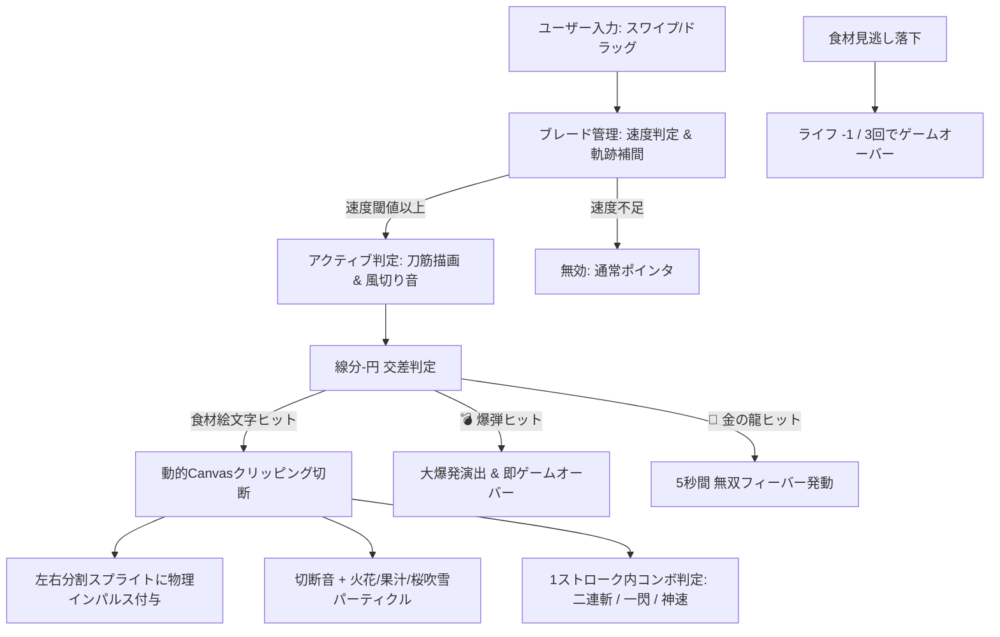

# 『爆裂！スラッシュ侍』実装計画書

「指一本でスパッと両断する圧倒的快感」をテーマにした、ゼロアセット・一筆書きスライスアクション（Fruit Ninja風）Webゲームの設計および実装計画です。

---

## 1. 全体アーキテクチャ & システム概要

- **単一ファイル構成**: `index.html` のみで動作（Phaser 3.80+ CDN読み込み、CSS、HTML、ゲームロジック、Web Audio APIプロシージャルサウンド）。
- **ゼロアセット設計**: 外部画像・音声ファイルは一切使わず、絵文字（Canvasレンダリング）＋Canvas動的クリッピング切断テクスチャ生成＋Web Audio APIオシレーター/ノイズ合成で完結。
- **対応環境**: PC（マウスドラッグ）およびスマートフォン・タブレット（タッチスワイプ）のマルチプラットフォーム。画面解像度は 720 × 1280（アスペクト比 9:16、`Phaser.Scale.FIT`）で自動センタリング。

---

## 2. コア技術・モジュール設計

### ① ブレードトレイル & スライス判定システム (`BladeManager`)
- **ポインタ追跡 & 速度算出**: 直近5〜10フレームの座標とタイムスタンプから瞬時速度 $v = \frac{\Delta d}{\Delta t}$ を計測。
- **アクティブ閾値**: 一定速度（例: 600px/s）以上でスワイプしている間のみブレード判定がONになり、墨絵・朱色・金色の光る筆跡トレイルを描画。
- **交差判定（線分 vs 円）**: 前フレームと現在フレームの座標を結ぶ線分 $L(p_1, p_2)$ と、浮遊するターゲットの中心 $C$、半径 $R$ との最短距離を算出（`Phaser.Geom.Intersects.LineToCircle`）。

### ② リアルタイムCanvas動的クリッピング切断 (`SliceEngine`)
- スライスされたターゲットの絵文字テクスチャを元に、スライス角度 $\theta$（スワイプ進行方向）に沿って切断。
- 角度 $\theta$ に合わせてCanvasを回転・クリッピングし、**「左半分（上半分）」と「右半分（下半分）」の2つの独立したCanvasテクスチャを瞬時に生成**。
- 生成した2つのスプライトに対して、切断線の法線方向（外側）へ初速ベクトルを与え、逆向きの角速度（回転）を加えて重力落下させる。

### ③ 墨絵・筆跡エフェクト & 和風パーティクル (`EffectManager`)
- **筆跡トレイル**: `Phaser.GameObjects.Graphics` によるグラデーション付きの筆跡ポリゴン描画（黒墨の芯＋朱色/黄金のオーラ＋時間減衰フェード）。
- **切断パーティクル**:
  - 白・金の閃光スライスライン（一瞬画面を横切るシャープな閃光）
  - 火花スパーク（散乱する光の粒子）
  - 桜吹雪（舞い散る 🌸 の花びら）
  - 食材ごとの果汁スプラッシュ（スイカ＝赤/緑、寿司＝橙、リンゴ＝赤 等）
- **画面シェイク & ヒットストップ**: スライス時に極小（20〜40ms）のヒットストップを挟み、心地よい「斬った手応え」を演出。

### ④ ゲームルール & スポーンシステム (`GameScene`)
- **ターゲット種類**:
  - **通常食材** (🍉 🍣 🍎 🍕 🍖 🍙 🍰 🍇 🍌 🍓 🥑): 斬るとスコア獲得＋割れる。落とすとライフ-1（❌表示）。
  - **爆弾 (💣)**: 導火線から火花を散らしながら飛来。斬ると即座に大爆発・ゲームオーバー。落としてもペナルティなし。
  - **金の龍 (🐉)**: 超高速で画面を横切るレアターゲット。斬るとボーナス得点 + **5秒間の「無双フィーバー」** 発動。
- **無双フィーバー**:
  - 画面全体が黄金に輝き、ゲーム内スピードがスロー（0.4倍）に変化。
  - 画面下から大量の食材絵文字が噴出し、爆弾の出現がストップ。
- **コンボ判定**: 1回のスワイプストロークで複数の食材を斬るとコンボ発動。
  - 2個: 「二連斬！」（スコア × 1.5）
  - 3個: 「一閃！」（スコア × 2.0）
  - 4個: 「神速！」（スコア × 3.0）
  - 5個以上: 「天下無双！」（スコア × 5.0）
- **難易度プログレッション**: 時間経過とともにスポーン頻度、同時射出数、射出速度、爆弾混入率が上昇。

### ⑤ Web Audio API プロシージャル和風サウンド (`SoundManager`)
- **刀の風切り音**: スワイプ時のホワイトノイズ + バンドパスフィルター周波数スイープ。
- **鋭い斬撃音**: 高周波FM変調オシレーター + 急速減衰。
- **破裂・果汁音**: 低域サイン波ピッチベンド + クリックノイズ。
- **爆弾爆発音**: 重低音ノイズバースト + 歪み（Distortion）。
- **コンボ時の和風ジングル**: 拍子木（カァン！）、和太鼓（ドン！）、琴風ペンタトニックスイープ。
- **龍スライス音**: 神秘的な和風ゴング + 鐘の響き。
- **和風BGM**: ペンタトニック（都節音階）によるミニマルで軽快なリズムトラック（ミュート切替ボタン付き）。

### ⑥ UI / UX & ソーシャル機能
- **タイトル画面**: スタイリッシュな筆文字タイトル ＋ 「画面をスワイプして開戦」。
- **HUD**: 現在スコア、コンボバナー、残機表示（❤️❤️❤️ / ❌❌❌）、フィーバーゲージ/タイマー。
- **ゲームオーバー画面**: 最終スコア、ハイスコア更新演出、ランク判定（見習い侍 〜 天下無双）、X（Twitter）シェアボタン、リトライボタン。
- **データ永続化**: `localStorage` を使用したハイスコア保存。

---

## 3. 実装対象ファイル

| ファイルパス | 操作 | 内容 |
| :--- | :---: | :--- |
| `index.html` | [NEW] | 全HTML, CSS, Phaser 3, Web Audio API, ゲームロジックを統合した完全完結型ファイル |

---

## 4. 検証・テスト計画

### 自動 / 手動検証
1. **動作確認**: ローカルHTTPサーバーを起動し、ブラウザで起動・レンダリング・エラーの有無を確認。
2. **スライス判定・速度閾値テスト**:
   - ゆっくりドラッグした時は切断されず、素早くシュッと振った時だけ切断されるか。
   - 複数の絵文字を同時に一筆書きした際に正常にコンボ判定が行われるか。
3. **Canvas切断描画テスト**:
   - 斬った角度に応じて絵文字が左右に綺麗に分かれ、回転しながら物理落下するか。
4. **ギミック検証**:
   - 💣（爆弾）を斬ると即ゲームオーバーになるか。
   - 食材を画面外に3回落とすとゲームオーバーになるか。
   - 🐉（金の龍）を斬ると無双フィーバー（スローモーション＆大量食材噴出）が発動するか。
5. **サウンド検証**:
   - スワイプ風切り音、斬撃音、コンボ拍子木音、爆発音が遅延なくクリアに鳴るか。
6. **データ・UI検証**:
   - ハイスコアが `localStorage` に保存され再起動後も保持されるか。
   - Xシェアリンクが正しいURLおよびテキストで生成されるか。
